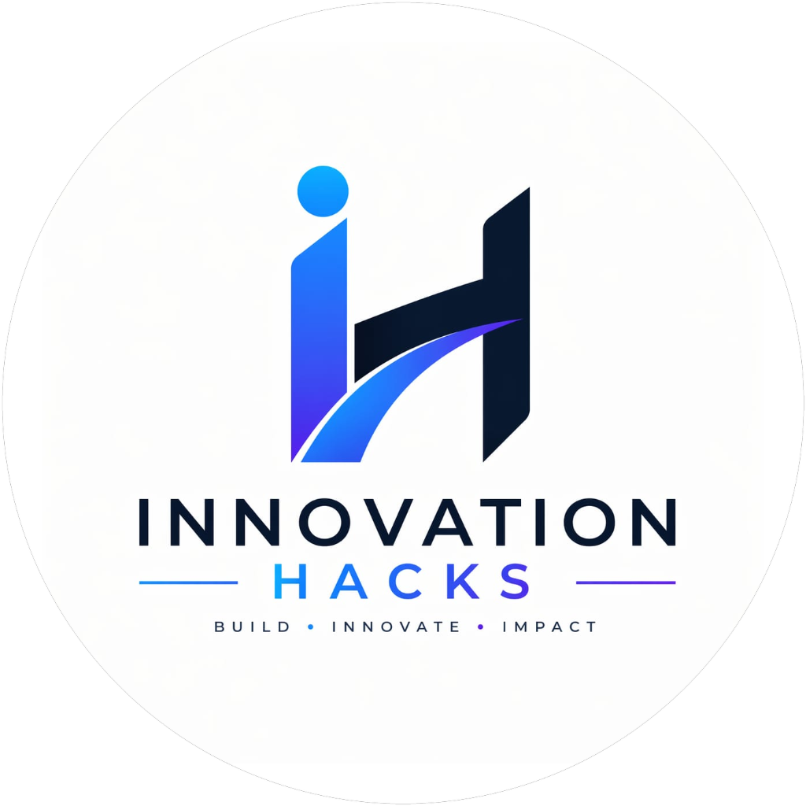

# AIVORA 2K26 — GLOBAL ONLINE AI HACKATHON

<p align="center">
  
</p>

<p align="center">
  <strong>BUILD • INNOVATE • IMPACT</strong>
</p>

<p align="center">
  <em>The premier global online AI hackathon organized by Innovation Hacks. Architecting the autonomous future with next-gen AI.</em>
</p>

<p align="center">
  
  
  
  
  
  
</p>

---

## 🌟 Overview

**AIVORA 2K26** is a global artificial intelligence hackathon organized by **Innovation Hacks**, uniting over 2,400+ visionary engineers, developers, and researchers across 150+ nations.

The platform provides a futuristic, high-tech experience backed by an end-to-end **Firebase Firestore** text database and **Cloudinary** media storage architecture, print-ready 300 DPI credential issuance, real-time participant verification, and dedicated portals for participants, winners, and honorable jury evaluators.

---

## 🚀 Key Features

- **🌐 Futuristic AI Web Platform (`index.html`)**
  - **Dark AI Design System**: Built with electric cyan (`#00D9FF`), vibrant violet (`#8B5CF6`), AI blue (`#3B82F6`), dark navy canvas (`#080D1B`), and glassmorphic cards (`#111C33`).
  - **Interactive Neural Network Canvas**: Real-time synaptically linked nodes that react dynamically to mouse movement and ambient pulses.
  - **Live Dynamic Stats Sync**: Real-time metrics fetched from Firebase Firestore database.
  - **5 Curated AI Challenge Tracks**: GenAI & LLMs, Autonomous Agents, Edge AI & Robotics, Healthcare AI, and Web3 & Decentralized Intelligence.
  - **3 Pillars**: BUILD, INNOVATE, IMPACT.
  - **3D Podium Arena**: Rewarding Top 3 Global Winners with guaranteed 1-month online internships, distinction trophies, and cash/hardware prizes.
  - **Interactive Credential Hub**: Multi-portal switcher for Attendees, Winning Teams, and Honorable Judges.
  - **12 Verified Event FAQs**: High-tech cyber accordion answering eligibility, rules, submission standards, and evaluation criteria.

- **⚡ Unified Firebase & Cloudinary Architecture**
  - **Firebase Firestore**: Collections for `participants`, `winner_codes`, `winner_claims`, `judge_codes`, `judge_certs`, `custom_templates`, `admin_config`, `site_stats`, and `contact_messages`.
  - **Cloudinary Media Storage**: Unsigned upload preset `aivora` (cloud `eo67rite`, folder `devloper`) for certificate templates and authority signatures.
  - **Resilient Dual Fallback**: LocalStorage and IndexedDB support ensures 100% uninterrupted offline testing and instant client rendering.

- **📜 Ultra-Crisp Certificate Engine (`cert-engine.js`)**
  - Print-ready A4 landscape rendering at 300 DPI (3508 × 2480 px).
  - Formats: Official Participation, 1st Prize Global Champion, 2nd Prize Global Runner-Up, 3rd Prize 2nd Runner-Up, and Judge Certificate of Appreciation.
  - Dynamic name auto-scaling, kerning, cryptographic verification stamps, and lossless PNG / vector-quality PDF export.
  - Cross-device coordinate synchronization (`nameX`, `nameY`).

- **🎛️ Specialized Event Portals**
  - **Admin Studio (`control.html`)**: Complete operational command center with live Firebase & Cloudinary configuration, connection diagnostics, Excel/CSV participant import, winner passkey studio, judge access code management, and visual template slider alignment.
  - **Distinction & Merit Portal (`winner.html`)**: Dedicated verification portal for hackathon prize winners and distinction awardees.
  - **Judge & Mentor Portal (`judges.html`)**: Official certificate portal for jury evaluators and session mentors.

---

## 🛠️ Tech Stack & Design Tokens

| Token / Layer | Value / Technology |
|---|---|
| **Primary Background** | `#080D1B` |
| **Secondary Background** | `#0D1428` |
| **Card Background** | `#111C33` |
| **Electric Cyan Accent** | `#00D9FF` |
| **Vibrant Violet Accent** | `#8B5CF6` |
| **AI Blue Accent** | `#3B82F6` |
| **Primary Text** | `#F8FAFC` |
| **Secondary Text** | `#A7B3C9` |
| **Card Borders** | `rgba(148, 163, 184, 0.18)` |
| **Success Indicator** | `#22C55E` |
| **Text & Records Database** | Firebase Firestore |
| **Media & Template Storage**| Cloudinary CDN (`eo67rite` / `aivora`) |
| **Certificate Engine** | HTML5 2D Canvas 300 DPI + jsPDF |

---

## 📦 Firebase & Cloudinary Setup

1. **Firebase Firestore Rules**:
   In your [Firebase Console](https://console.firebase.google.com) under Firestore Database -> Rules, ensure:
   ```javascript
   rules_version = '2';
   service cloud.firestore {
     match /databases/{database}/documents {
       match /{document=**} {
         allow read, write: if true;
       }
     }
   }
   ```
2. **Cloudinary Upload Preset**:
   - Cloud Name: `eo67rite`
   - Upload Preset: `aivora` (Signing Mode: **Unsigned**)
   - Asset folder: `devloper`

---

## 💻 Local Development

```bash
# Start local development server
npm run dev
# or
node server.cjs
```

Visit `http://localhost:3000` in your web browser.

---

## 📁 Repository Structure

```text
├── index.html                   # Official AIVORA 2K26 Homepage & Credential Portal
├── control.html                 # Admin Studio & Management Center
├── winner.html                  # Distinction & Winner Verification Portal
├── judges.html                  # Judge Appreciation Certificate Portal
├── cert-engine.js               # 300 DPI Canvas Certificate Engine
├── firestore.rules              # Firestore Database Security Rules
├── .env.example                 # Firebase & Cloudinary configuration reference
├── js/
│   ├── firebase-config.js       # Unified Firebase Firestore & Cloudinary Backend Layer
│   ├── supabase-config.js       # Backward-compatibility bridge
│   └── main.js                  # Neural Canvas, Modals, Accordion, Verification & Stats
├── css/
│   └── style.css                # AIVORA 2K26 Cyber AI Design System & Styles
└── assets/                      # Brand assets, artwork, and certificate templates
```

---

## 📜 License

This project is licensed under the **ISC License**. Organized by **INNOVATION HACKS** — *BUILD • INNOVATE • IMPACT*.
